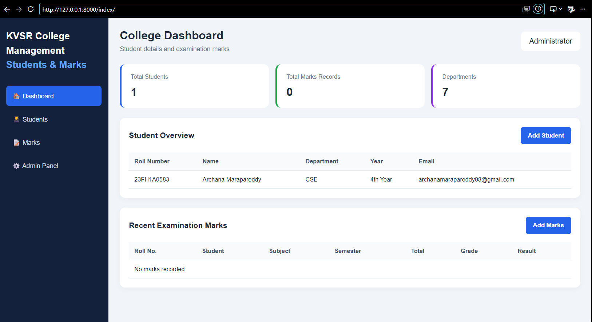

# KVSR College Management - Students & Marks

A Django project for College Dashboard to manage Student details and Examination marks.

Created by: Archana Marapareddy (23FH1A0583)

## Features
- Dashboard with Total Students, Marks Records, Departments
- Student Overview (Roll No, Name, Department, Year, Email)
- Recent Examination Marks
- Admin Panel

## Tech Stack
- Python Django
- HTML, CSS
- SQLite Database

## How to Run
```bash
python manage.py migrate
python manage.py runserver
```
Then open http://127.0.0.1:8000/index/


